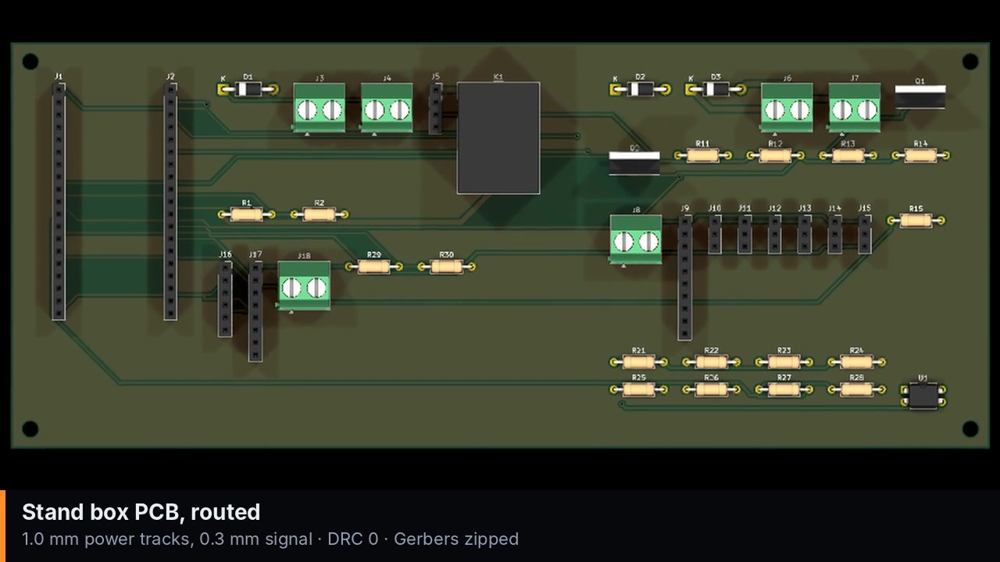
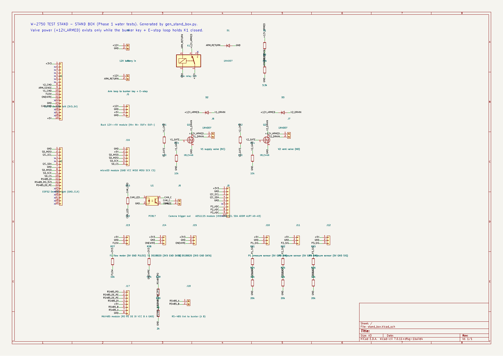
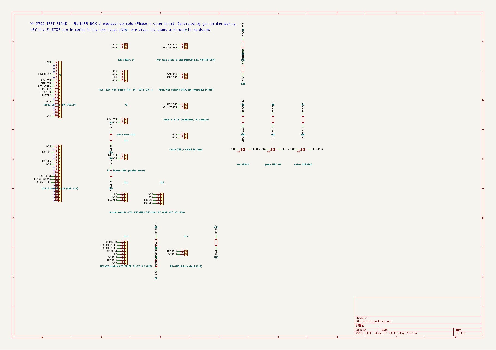
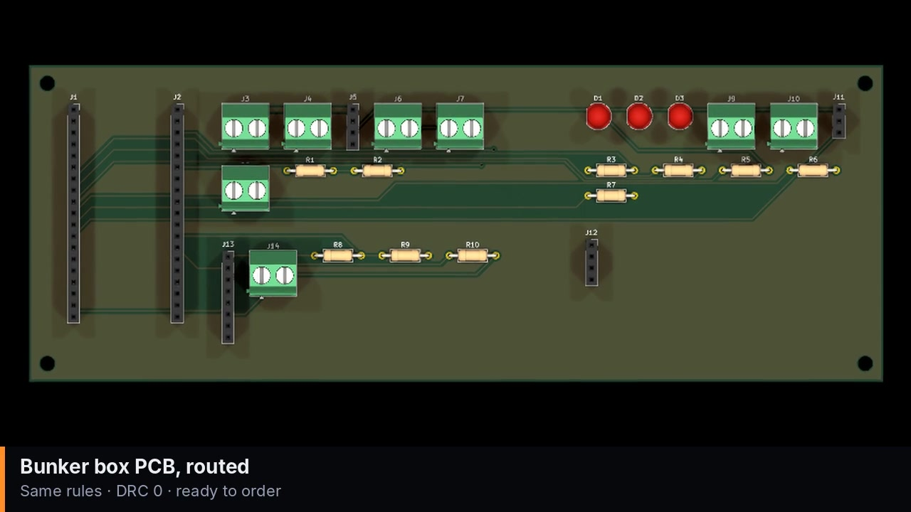

# W-2750 test stand electronics

Two boards for the W-2750 engine test stand, Phase 1 (water tests). All of this is design and simulation. Nothing has been built yet.

## The two boards

**Stand box** (next to the engine). An ESP32 reads the sensors, drives the valves and logs to a microSD card.
- Valves: V1 supply (normally closed) and V2 vent (normally open), switched by IRLZ44N MOSFETs.
- Arm relay: the valves only get 12 V while the arm loop from the bunker is closed.
- Sensors: 3 pressure transducers through an ADS1115, a flow meter, 2 DS18B20 temperature probes.
- Camera trigger through a PC817 optocoupler. RS-485 link to the bunker.

**Bunker box** (the firing console). An ESP32 with key switch, mushroom E-stop, ARM and guarded FIRE buttons, ARMED / LINK / RUN lamps, buzzer and OLED. No sensors.

## Safety chain

1. **Hardware arm loop.** The stand's 12 V goes down the cable, through the key and the E-stop, and back to the arm relay. Breaking it removes valve power with no software involved. Supply closes, vent opens.
2. **Link-loss interlock.** The bunker sends a heartbeat every 200 ms. No heartbeat for 500 ms during countdown or run: the stand closes supply, opens vent and latches safe.
3. **Pressure redline** (8 bar on P2 for water tests).
After any abort the stand stays safe until the arm key is cycled.

## Firmware

`firmware/stand_controller_v2/sketch.ino` (Arduino C++ for ESP32). Commands over RS-485: `HB`, `STATUS`, `CAL_P`, `CAL_IMU`, `FIRE`, `ABORT`.
It runs in the Wokwi simulator (`diagram.json`). Results in `firmware/TEST_RESULTS.md`, logs in `firmware/test_logs/`:

| Case | Result |
|---|---|
| 1 Normal: calibrate, countdown, 5 s run | PASS |
| 2 Interlocks: FIRE refused before arming or calibrating, ABORT latches | PASS |
| 3 Link loss during run | PASS, safe after 500 ms without heartbeat |
| 4 IMU drift before and after calibration | PASS |

## Schematics

`kicad/` holds both KiCad schematics (0 ERC errors), PDFs and the Python scripts that generate them. The routed board files and Gerbers are kept offline and are not yet in this folder.

## Not done yet

- Real hardware build and bench test.
- Hardware watchdog (ESP32 watchdog plus an external dead-man relay).
- Bunker firmware (the Serial monitor stood in for the bunker in the tests).
- Hot-fire instrumentation: kHz-rate pressure converter, thermocouples, load cell.

Kelechi Ogbonna, Wakanda Series. Free and open tools: KiCad, Wokwi, Freerouting.
